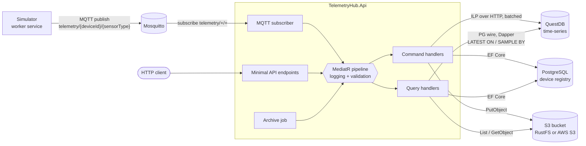

# telemetry-hub

Real-time industrial IoT telemetry ingestion API built with .NET 10.

Sensors on industrial equipment (pressure, temperature, vibration) publish readings over MQTT.
The API validates each reading, stores it in a time-series database, serves query endpoints
with windowed aggregations and periodically archives aggregated data to S3-compatible object
storage. The whole system runs locally with one Docker Compose command. No cloud account is
needed.

## Architecture



The write path and the read path are separate all the way down (CQRS): readings are written
through the InfluxDB Line Protocol client and read through SQL over the PostgreSQL wire
protocol.

### Layers

| Project | Responsibility |
| --- | --- |
| `TelemetryHub.Domain` | `Device`, `Reading`, `SensorType`, `SampleInterval`. No dependencies. |
| `TelemetryHub.Application` | Commands, queries, handlers, FluentValidation validators, MediatR pipeline behaviors and the abstractions the handlers need (`IReadingWriter`, `IReadingQueries`, `IArchiveStorage`, `IDeviceRepository`). |
| `TelemetryHub.Infrastructure` | MQTT subscriber, QuestDB writer and queries, S3 storage, EF Core persistence, archive job, health checks. |
| `TelemetryHub.Api` | Minimal API endpoints, problem details mapping, OpenAPI, composition root. |
| `TelemetryHub.Simulator` | Stand-alone worker that publishes fake sensor readings. |

Dependencies point inward: Api and Infrastructure depend on Application, Application depends
on Domain. Handlers only see interfaces, so the unit tests replace every integration with an
in-memory fake.

## Run it

Requirements: Docker with Compose.

```bash
cp .env.example .env
docker compose up -d --build
```

That starts Mosquitto, QuestDB, PostgreSQL, RustFS (S3-compatible storage), the API and the
simulator. A one-shot `s3-init` container creates the archive bucket. After a few seconds:

| What | Where |
| --- | --- |
| API docs (Scalar) | http://localhost:8080/docs |
| OpenAPI document | http://localhost:8080/openapi/v1.json |
| Readiness | http://localhost:8080/health/ready |
| QuestDB console | http://localhost:9000 |
| RustFS console | http://localhost:9101/rustfs/console/ (keys from `.env`) |

Stop and remove everything, including data volumes:

```bash
docker compose down -v
```

## Try the endpoints

The simulator publishes for devices `pump-001` to `pump-005`.

Latest reading of each sensor:

```bash
curl http://localhost:8080/api/devices/pump-001/readings/latest
```

```json
[
  { "sensorType": "pressure", "value": 8.502, "unit": "bar", "timestamp": "2026-01-31T10:15:41.728568+00:00" },
  { "sensorType": "temperature", "value": 67.689, "unit": "degC", "timestamp": "2026-01-31T10:15:41.728568+00:00" },
  { "sensorType": "vibration", "value": 2.179, "unit": "mm/s", "timestamp": "2026-01-31T10:15:41.728568+00:00" }
]
```

Time series with avg, min and max per window. `from` and `to` default to the last hour,
`interval` to `1m`:

```bash
curl "http://localhost:8080/api/devices/pump-001/readings/series?sensorType=pressure&interval=10s"
```

```json
{
  "deviceId": "pump-001",
  "sensorType": "pressure",
  "from": "2026-01-31T09:15:43+00:00",
  "to": "2026-01-31T10:15:43+00:00",
  "interval": "10s",
  "points": [
    { "timestamp": "2026-01-31T10:15:20+00:00", "avg": 7.7667, "min": 7.684, "max": 7.84, "count": 10 },
    { "timestamp": "2026-01-31T10:15:30+00:00", "avg": 7.7467, "min": 7.58, "max": 8.62, "count": 10 }
  ]
}
```

Archived files. The background job writes one file per device for every complete window
(5 minutes by default), so the list fills up a few minutes after startup:

```bash
curl "http://localhost:8080/api/archives?deviceId=pump-001"
```

```bash
curl "http://localhost:8080/api/archives/files/readings/date=2026-01-31/device=pump-001/20260131T101500Z_20260131T102000Z.json"
```

Device registry:

```bash
curl -X POST http://localhost:8080/api/devices -H "Content-Type: application/json" -d '{"deviceId":"pump-001","name":"Feed pump 1","location":"Unit A"}'
```

### All endpoints

| Method | Path | Description |
| --- | --- | --- |
| GET | `/api/devices` | Paged list, optional `isActive` filter |
| GET | `/api/devices/{deviceId}` | One device |
| POST | `/api/devices` | Register a device |
| PUT | `/api/devices/{deviceId}` | Update name, location, active flag |
| DELETE | `/api/devices/{deviceId}` | Remove a device |
| GET | `/api/devices/{deviceId}/readings/latest` | Last reading of each sensor |
| GET | `/api/devices/{deviceId}/readings/series` | Aggregated series: `sensorType`, `from`, `to`, `interval` |
| GET | `/api/archives` | Archived files, optional `date` and `deviceId` filters |
| GET | `/api/archives/files/{key}` | Download one archived file |
| POST | `/api/archives/run` | Archive a specific window on demand |
| GET | `/health/live`, `/health/ready` | Liveness and readiness (Postgres, QuestDB, MQTT, S3) |

Errors are returned as RFC 9457 problem details: 400 with per-field messages for validation,
404 and 409 for missing and conflicting resources.

### MQTT contract

Topic: `telemetry/{deviceId}/{sensorType}`, where `sensorType` is `pressure`, `temperature`
or `vibration`.

```json
{ "value": 8.42, "unit": "bar", "timestamp": "2026-01-31T10:15:00Z" }
```

`timestamp` is optional; the arrival time is used when it is missing. Malformed or invalid
messages are logged, counted and dropped without interrupting the subscription.

## Configuration

Every address and credential comes from environment variables. `.env.example` has working
local values; `.env` is ignored by git.

| Variable | Purpose |
| --- | --- |
| `MQTT_HOST`, `MQTT_PORT`, `MQTT_USERNAME`, `MQTT_PASSWORD`, `MQTT_TOPIC_PREFIX`, `MQTT_CLIENT_ID` | Broker connection and topic prefix |
| `QUESTDB_HOST`, `QUESTDB_HTTP_PORT`, `QUESTDB_PG_PORT`, `QUESTDB_USER`, `QUESTDB_PASSWORD`, `QUESTDB_DATABASE` | QuestDB for writes (HTTP) and reads (PG wire) |
| `POSTGRES_HOST`, `POSTGRES_PORT`, `POSTGRES_DB`, `POSTGRES_USER`, `POSTGRES_PASSWORD` | Device registry database |
| `S3_SERVICE_URL`, `S3_FORCE_PATH_STYLE`, `S3_REGION`, `S3_BUCKET`, `S3_ACCESS_KEY`, `S3_SECRET_KEY` | Object storage |
| `ARCHIVE_INTERVAL_SECONDS`, `ARCHIVE_WINDOW_MINUTES`, `ARCHIVE_GRACE_SECONDS` | Archive job schedule and window size |
| `SIMULATOR_DEVICE_COUNT`, `SIMULATOR_INTERVAL_MS` | Simulated load |

### Using real AWS S3

No code change. Leave `S3_SERVICE_URL` empty, set `S3_FORCE_PATH_STYLE=false`, and set
`S3_REGION`, `S3_BUCKET` and the keys. With empty keys the SDK falls back to the default AWS
credential chain (environment, profile, IAM role).

## Technical decisions

**Reading from QuestDB: Dapper, not EF Core.** QuestDB speaks the PostgreSQL wire protocol,
so both work through Npgsql. EF Core would add little here: there are no migrations to manage,
no change tracking, no relationships, and the queries that matter use QuestDB's time-series
extensions (`LATEST ON`, `SAMPLE BY`), which LINQ cannot express, so they would be raw SQL
anyway. Dapper maps those hand-written queries to DTOs with far less machinery. EF Core is
used where it fits: the relational device registry in PostgreSQL, with migrations. Type
loading is disabled on the QuestDB data source because QuestDB does not implement the
PostgreSQL type catalog.

**Writing to QuestDB: ILP, batched.** Writes go through the official `net-questdb-client`
over ILP/HTTP, the path QuestDB optimizes for ingestion. The writer buffers rows and sends a
batch when it reaches a size limit or when a timer fires, whichever comes first, so
throughput is high under load and latency stays bounded when traffic is low. If a batch
fails after the client's own retries, it is dropped and logged rather than blocking
everything behind it.

**Idempotent ingestion.** MQTT QoS 1 means at-least-once delivery, so duplicates are
expected. The `readings` table is created explicitly with
`DEDUP UPSERT KEYS(timestamp, device_id, sensor_type)`, which makes a redelivered reading a
no-op. There is an integration test for this.

**Idempotent archiving.** Archive windows are aligned to the clock and object keys are
derived from the window (`readings/date=YYYY-MM-DD/device={id}/{start}_{end}.json`).
Archiving the same window twice overwrites the same objects. The job waits a short grace
period after a window ends so late readings are included. The key layout uses Hive-style
partitions, which query engines can read directly.

**MediatR 12.5.** Later MediatR versions moved to a commercial license that needs a license
key. 12.5.0 is the last Apache-2.0 release and has everything this project uses. Every
request, whether it arrives by HTTP, MQTT or the background job, goes through the same
pipeline: a logging behavior and a FluentValidation behavior.

**SAMPLE BY interval as a value object.** `SAMPLE BY` does not accept a bind parameter, so
the interval has to be written into the SQL text. It is parsed into `SampleInterval`, which
only ever renders digits followed by one of `s`, `m`, `h`, `d`. Responses are capped at 5000
points so a small interval over a long range cannot flood the API.

**RustFS as the local S3.** The official MinIO images are no longer published, so the
compose stack uses RustFS, an open source S3-compatible server. The application only knows
the S3 API through `AWSSDK.S3`; the endpoint, path-style addressing and credentials are
configuration.

**JSON archives.** Files are small aggregates meant to be easy to inspect. For large raw
exports a columnar format such as Parquet would be the next step, and only the
serialization in the archive handler would change.

**Options validated at startup.** Missing or invalid configuration stops the process with a
clear message instead of failing on the first request.

## Tests

```bash
dotnet test
```

- **Unit tests** cover handlers, validators, pipeline behaviors, the MQTT message parser,
  archive keys and window alignment. Integrations are replaced by in-memory fakes of the
  application interfaces.
- **Integration tests** use Testcontainers to start PostgreSQL, QuestDB, Mosquitto and an
  S3-compatible store, host the API in-process against them and exercise the real flow:
  publish over MQTT, query the series over HTTP, archive a window, list and download the file.
  They need Docker running.

## Development

Requirements: .NET 10 SDK and Docker.

```bash
dotnet build
dotnet test
```

To run the API outside Docker, start only the dependencies with
`docker compose up -d mosquitto questdb postgres rustfs s3-init` and export the settings
with `localhost` hosts using the .NET naming (`Postgres__Host`, `QuestDb__Host`,
`Mqtt__Host`, `S3__ServiceUrl`, and so on; see the `api` service in `docker-compose.yml`
for the full list).

Add a migration for the device registry:

```bash
dotnet tool restore
dotnet ef migrations add <Name> --project src/TelemetryHub.Infrastructure --startup-project src/TelemetryHub.Infrastructure --output-dir Persistence/Migrations
```

Migrations are applied when the API starts.

## Known limits

- No authentication on the API or the broker; this is a local demonstration.
- The archive job keeps its position in memory. After downtime it resumes from the latest
  complete window and does not backfill the windows it missed; `POST /api/archives/run`
  can archive any window on demand.
- Readings are accepted for any well-formed device id, registered or not. The registry and
  the telemetry stream are intentionally decoupled.

## License

[MIT](LICENSE)
